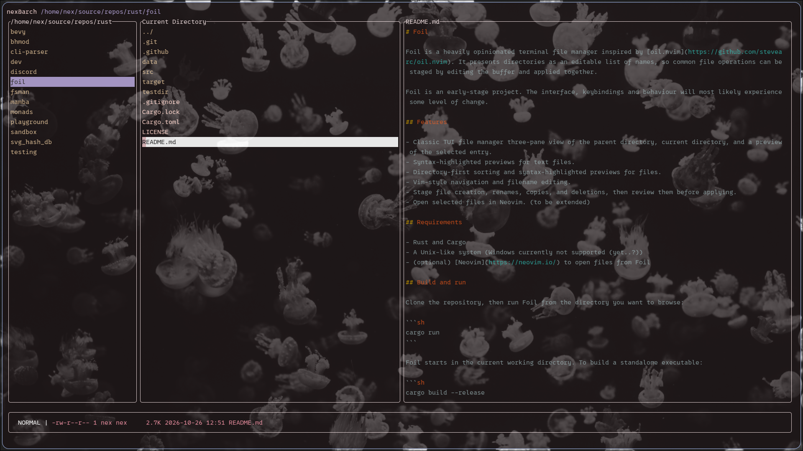
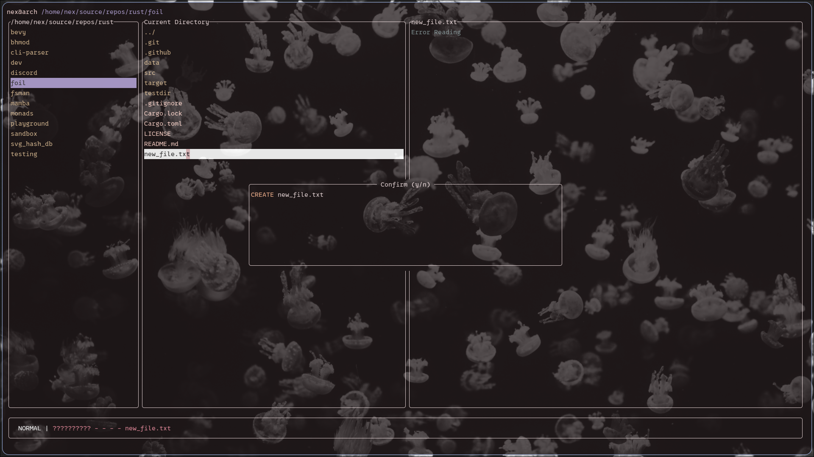

# Foil

Foil is a heavily opinionated terminal file manager inspired by [oil.nvim](https://github.com/stevearc/oil.nvim). It presents directories as an editable list of names, so common file operations can be staged by editing the buffer and applied together.

Foil is an early-stage project. The interface, keybindings and behaviour will most likely experience some level of change.

<p float="left">
  
   
</p>


## Features

- Classic TUI file manager three-pane view of the parent directory, current directory, and a preview of the selected entry.
- Syntax-highlighted previews for text files.
- Directory-first sorting and syntax-highlighted previews for files.
- Vim-style navigation and filename editing.
- Stage file creation, renames, copies, and deletions, then review them before applying.
- Open selected files in Neovim. (to be extended)

## Requirements

- Rust and Cargo
- A Unix-like system (Windows currently not supported (yet..?))
- (optional) [Neovim](https://neovim.io/) to open files from Foil

## Build and run

Clone the repository, then run Foil from the directory you want to browse:

```sh
cargo run
```

Foil starts in the current working directory. To build a standalone executable:

```sh
cargo build --release
```

The executable is written to `target/release/foil`.

## Using Foil

The current directory is shown in the middle pane. The first row, `../`, navigates to its parent. Select a directory and press `Enter` to open it. Select a file and press `Enter` to open it in Neovim.
(This is where the opinionated part comes in: Enter is used to open files/directories which is different from what you would expect from a Neovim-like application. I am open to suggestions on this)

### Normal mode

| Key | Action |
| --- | --- |
| `h` / `j` / `k` / `l`, or arrow keys | Move the cursor |
| `gg` / `G` | Go to the first / last row |
| `w` / `e` / `b` | Move by word |
| `0` / `$` | Move to the start / end of a filename |
| `i`, `a`, `I`, `A` | Edit the selected filename |
| `o` / `O` | Insert a filename row below / above |
| `Esc` | Leave insert mode or cancel a pending key sequence |
| `dd` | Stage the selected entry for deletion |
| `yy`, then `p` | Stage a copy of the selected entry in the current directory |
| `x` | Remove the character under the cursor from the selected filename |
| `u` | Undo the last buffer change |
| `:w` | Review staged file operations |
| `:q` or `:qa` | Quit (`:qa` added for those of us with stubborn muscle-memory) |

Edits are staged in the directory listing. After `:w`, Foil shows a summary; press `y` to apply the listed operations or `n` / `Esc` to cancel. Quitting with `:q` or `:qa` exits without applying staged operations.
(`:q!` to be added later)

## License

Foil is licensed under the [MIT License](LICENSE).
